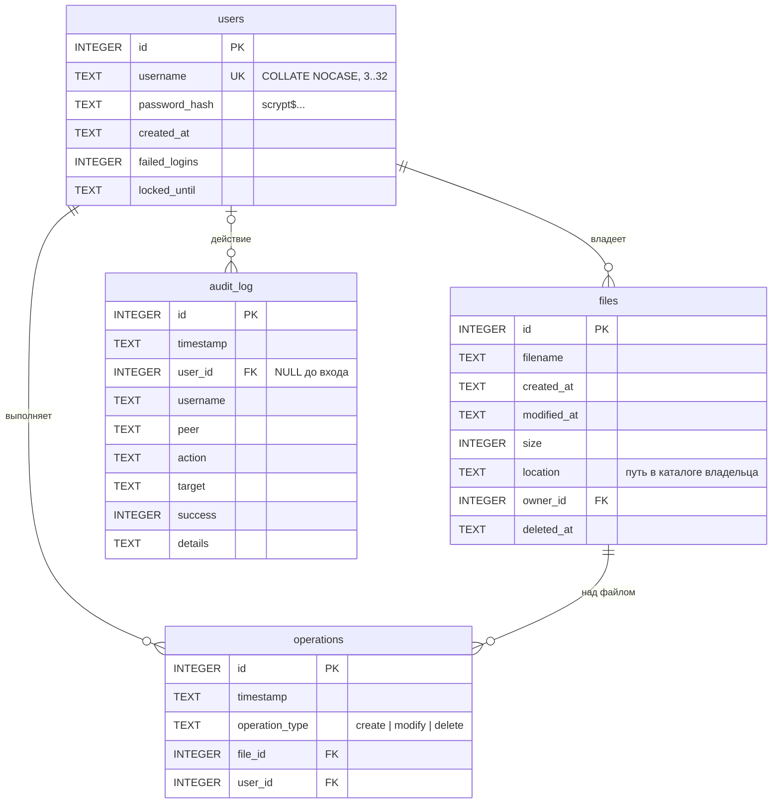

# База данных

СУБД — SQLite из стандартной библиотеки Python (`sqlite3`). Задание разрешает
PostgreSQL, MySQL или SQLite. SQLite выбрана потому, что не требует отдельного
сервера: база — один файл, и проект запускается на чистом Python без установки
чего-либо.

Схема — [`server/db/schema.sql`](../server/db/schema.sql), запросы —
[`server/db/repository.py`](../server/db/repository.py).

---

## 1. Схема



Три первые таблицы — вариант из задания. Четвёртая, `audit_log`, — журнал
активности (пункт 6 требований): в нём каждая команда каждого клиента,
включая неудачные входы и отказы.

### Отличия от примера в задании

| В задании (PostgreSQL) | Здесь (SQLite) | Причина |
|---|---|---|
| `SERIAL` | `INTEGER PRIMARY KEY AUTOINCREMENT` | Синтаксис SQLite; `AUTOINCREMENT` не переиспользует id удалённых строк |
| `ENUM ('create','modify','delete')` | `TEXT CHECK (operation_type IN (...))` | Типа ENUM в SQLite нет; CHECK даёт то же ограничение |
| `VARCHAR(50)` | `TEXT CHECK (length(...) BETWEEN ...)` | SQLite не проверяет длину VARCHAR — ограничение задано явно |
| `TIMESTAMP` | `TEXT` в формате `ГГГГ-ММ-ДД ЧЧ:ММ:СС.ссс`, UTC | Типа времени в SQLite нет; такие строки сравниваются как даты |
| Хранимые процедуры | Триггеры | Процедур в SQLite нет (см. §3) |

### Дополнительные поля

| Поле | Зачем |
|---|---|
| `users.failed_logins`, `users.locked_until` | Блокировка после серии неудачных входов |
| `files.modified_at` | Время последнего изменения |
| `files.deleted_at` | Удалённый файл помечается, а не стирается: на него ссылается журнал операций |

### Ограничения целостности

- `users.username UNIQUE COLLATE NOCASE` — «Admin» и «admin» не могут
  существовать одновременно.
- `users.password_hash CHECK (LIKE 'scrypt$%')` — пароль открытым текстом в
  таблицу не попадёт даже из-за ошибки в коде.
- `files_live_location` — частичный уникальный индекс: у владельца на один
  путь одна живая запись, удалённых — сколько угодно.
- Внешние ключи включаются для каждого соединения (`PRAGMA foreign_keys = ON`):
  в SQLite они по умолчанию выключены.

---

## 2. Как связаны файл на диске и запись в базе

`location` — путь внутри каталога владельца через `/`, например
`docs/report.txt`. Абсолютный путь на сервере в базу не пишется.

| Действие | Что делает сервер с `files` | Что появляется в `operations` |
|---|---|---|
| Создание файла (`write`, `json_write`, `xml_write`, `zip`, `unzip`) | `INSERT` | `create` |
| Перезапись | `UPDATE size, modified_at` | `modify` |
| Удаление | `UPDATE deleted_at` | `delete` |
| Создание на месте удалённого | `INSERT` новой строки | `create` с новым `file_id` |

Создание каталогов в `operations` не попадает — таблица описывает файлы, —
но фиксируется в журнале аудита.

Если файл появился на диске в обход сервера и затем удаляется командой `rm`,
он сначала регистрируется, потом помечается удалённым — удаление оставляет
след в любом случае.

Распакованные из архива файлы записываются одной транзакцией: сбой посреди
сотни записей не оставит реестр заполненным наполовину.

---

## 3. Триггеры вместо хранимых процедур

Задание рекомендует хранимые процедуры. Их смысл — правило выполняется в базе,
а не в приложении, поэтому его нельзя обойти или забыть. В SQLite процедур нет;
то же свойство дают триггеры.

### Журнал операций ведёт база

Приложение меняет только таблицу `files`. Записи в `operations` создают
триггеры:

```sql
CREATE TRIGGER files_log_modify
AFTER UPDATE OF size, modified_at ON files
WHEN OLD.deleted_at IS NULL AND NEW.deleted_at IS NULL
BEGIN
    INSERT INTO operations (operation_type, file_id, user_id)
    VALUES ('modify', NEW.id, NEW.owner_id);
END;
```

Изменить файл в базе и не оставить записи в журнале нельзя в принципе — даже
выполнив `UPDATE` вручную. Тест `test_запись_файла_без_журнала_невозможна`.

### История неизменяема

| Триггер | Запрещает |
|---|---|
| `operations_no_update`, `operations_no_delete` | Правку и удаление журнала операций |
| `audit_log_no_update`, `audit_log_no_delete` | Правку и удаление журнала аудита |
| `files_no_delete` | Удаление записей о файлах |
| `files_identity_immutable` | Смену владельца, пути, имени, времени создания |
| `files_no_undelete` | Снятие пометки об удалении задним числом |

---

## 4. Запросы

Все запросы — подготовленные выражения с параметрами `?`
(подробно — [security.md](security.md#3-sql-инъекция)). Примеры:

```python
# Поиск пользователя: логин передаётся параметром, а не вклеивается в текст.
conn.execute(
    "SELECT id, username, password_hash, ... FROM users WHERE username = ?",
    (username,),
)

# Неудачный вход: приращение в самой базе, без «прочитать — прибавить — записать».
conn.execute("UPDATE users SET failed_logins = failed_logins + 1 WHERE id = ?", (user_id,))
```

Для чтения журнала операций есть представление `operations_view`, которое
соединяет `operations`, `files` и `users`.

---

## 5. Конкурентный доступ

- Соединение открывается на каждую единицу работы и сразу закрывается:
  объект соединения `sqlite3` нельзя делить между потоками.
- Транзакции записи начинаются с `BEGIN IMMEDIATE` — сразу захватывают право
  записи. Вторая такая транзакция ждёт первую до 10 секунд, а не падает с
  «database is locked» посреди работы.
- Режим журнала WAL: читатели не блокируют писателя и наоборот.

---

## 6. Где лежит и как посмотреть

По умолчанию — `data/filemanager.db` относительно каталога запуска
(`--db` или `FM_DB` меняют путь). Каталоги `data/` и `storage/` исключены из
репозитория.

Просмотреть базу можно любым клиентом SQLite, например из Python:

```bash
python -c "import sqlite3; c = sqlite3.connect('data/filemanager.db'); print(*c.execute('SELECT * FROM operations_view'), sep='\n')"
```
