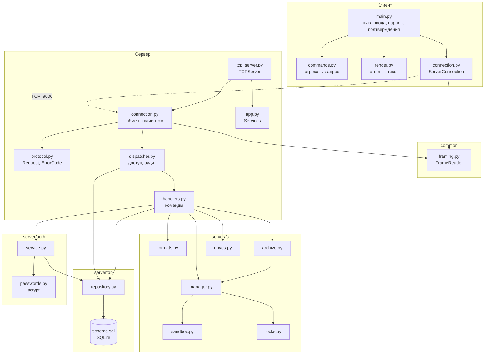
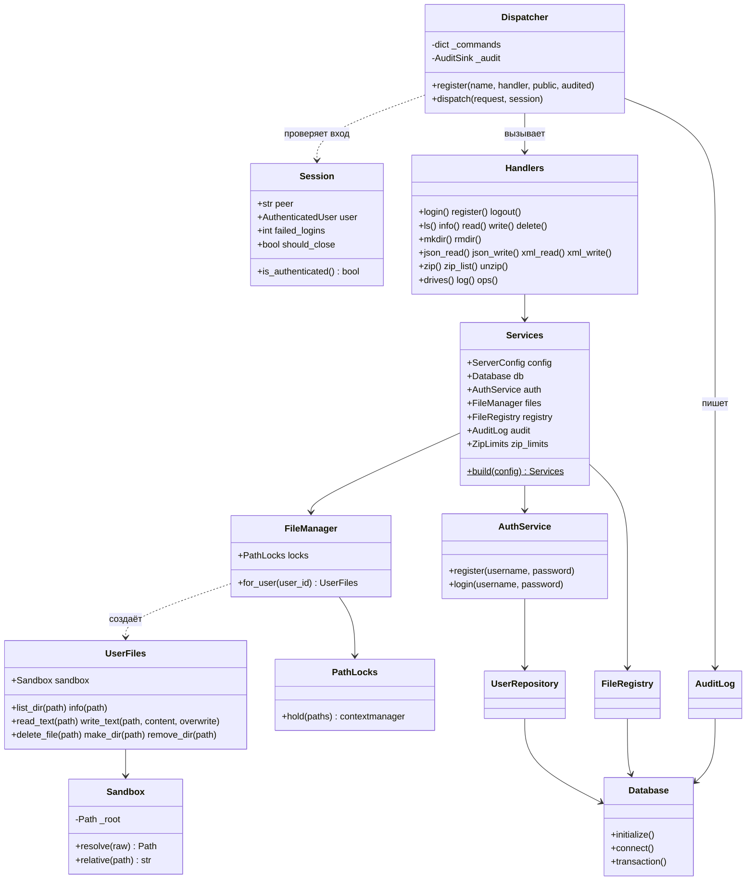
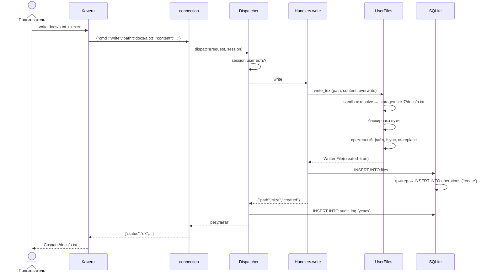
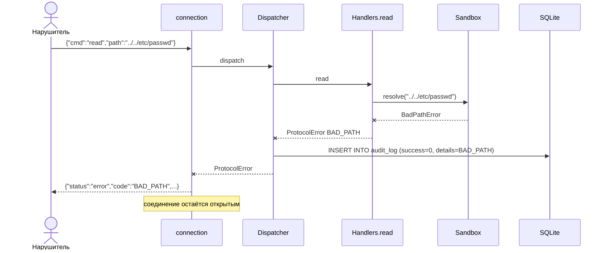
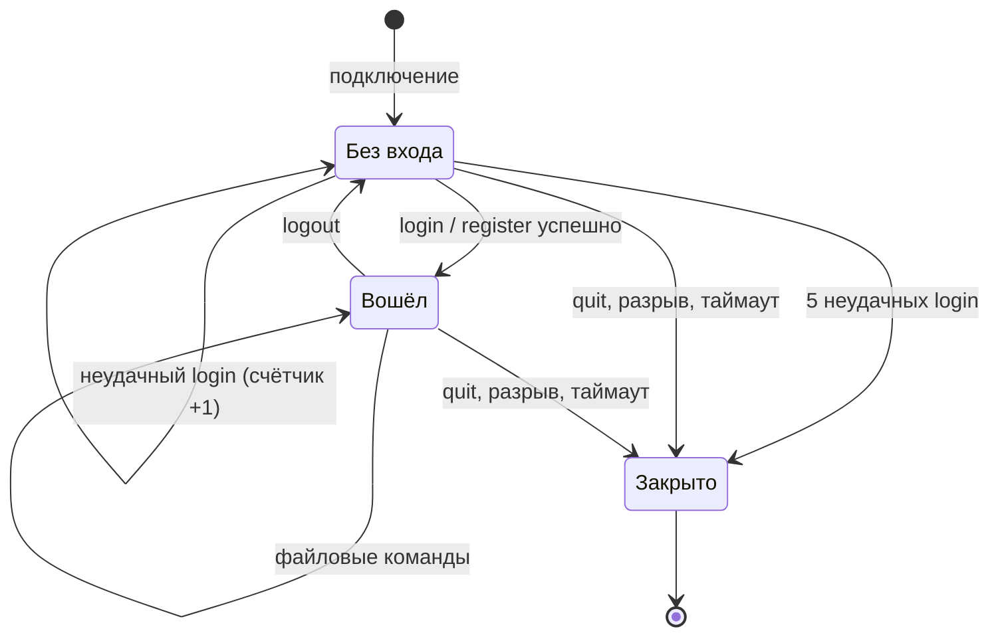
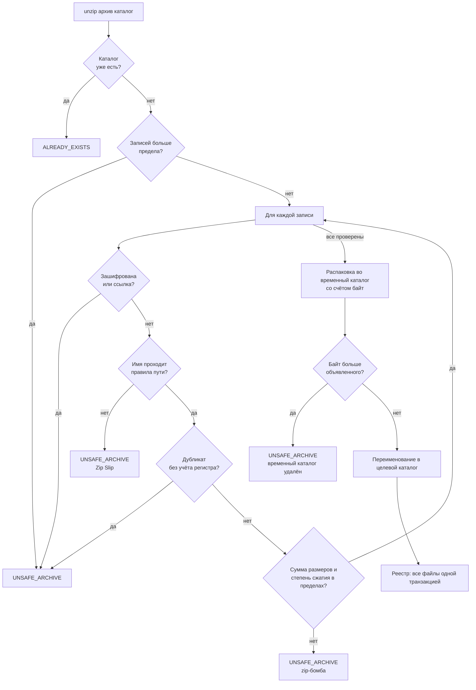
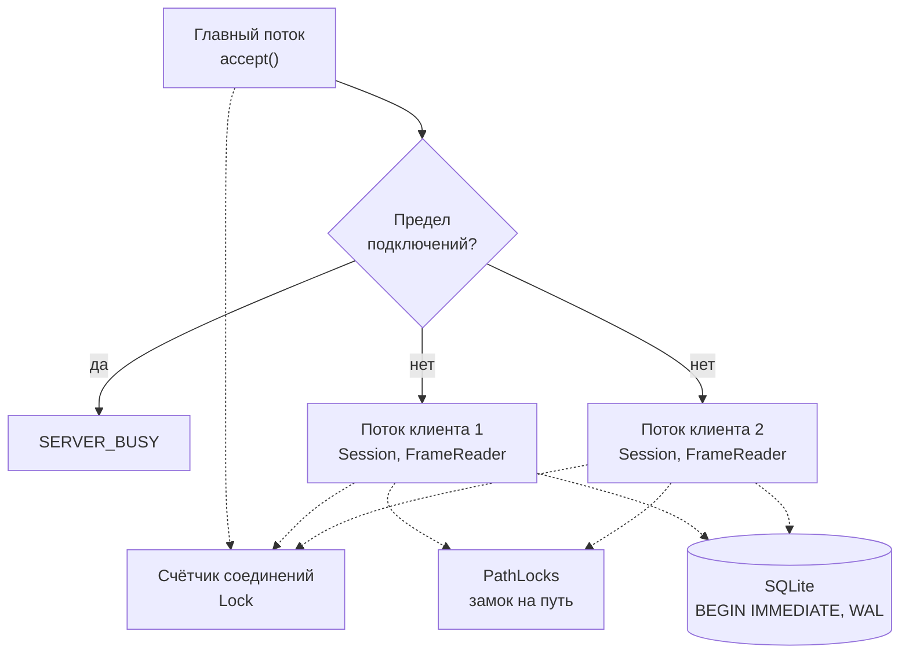
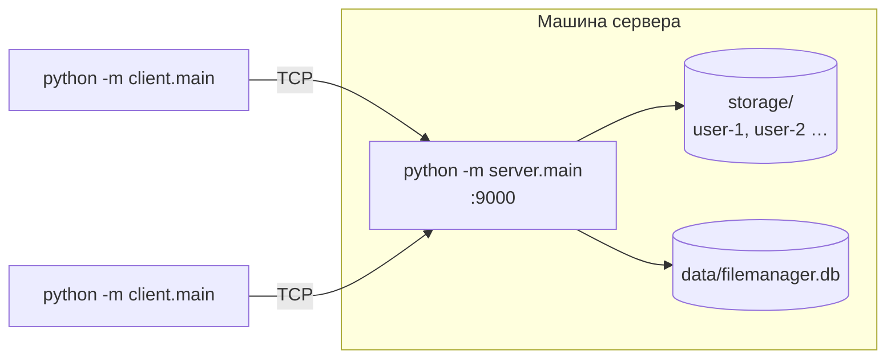

# Диаграммы

Все диаграммы записаны на языке Mermaid и отрисовываются GitHub автоматически —
исходный текст остаётся в репозитории и правится вместе с кодом.
Схема базы данных — в [database.md](database.md#1-схема).

---

## 1. Диаграмма компонентов

Пакеты `fs`, `db`, `auth` не имеют стрелок в сторону сети и протокола —
поэтому тестируются без сокетов.

---

## 2. Диаграмма классов: сервер

---

## 3. Последовательность: запись файла

---

## 4. Последовательность: отражённая атака

Попытка выйти из каталога не доходит до файловой системы, но оставляет след.

---

## 5. Состояния сессии

В состоянии «Без входа» доступны только `register`, `login`, `ping`, `quit`;
остальное получает `AUTH_REQUIRED`.

---

## 6. Деятельность: распаковка архива

Все проверки по заголовкам — до записи первого байта; счёт байт — на случай,
если заголовки лгут.

---

## 7. Потоки сервера

---

## 8. Развёртывание

Штатно — всё на одной машине через `127.0.0.1`. Шифрования нет, поэтому по
сети — только в доверенной.
